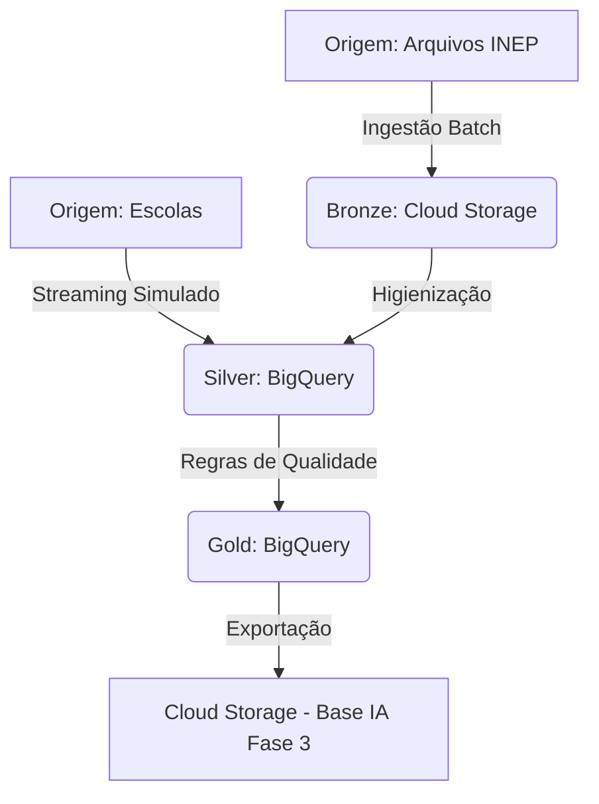

# Tech Challenge - Fase 2: Pipeline de Dados Educacionais (INEP)

**Link do vídeo executivo:** https://youtu.be/0gvFF90mDyQ

## Contexto do Problema

O monitoramento da alfabetização infantil é um dos maiores desafios educacionais do Brasil. O uso de dados públicos do INEP permite acompanhar o desempenho dos municípios em relação às metas estabelecidas para 2030. Este projeto constrói a infraestrutura de dados necessária para ingerir, tratar e disponibilizar esses indicadores oficiais com alta confiabilidade, servindo de base para análises de políticas públicas e futuros modelos preditivos.

## Arquitetura Proposta

A solução foi desenhada baseada na Arquitetura Medalhão. O fluxo de dados reflete exatamente a infraestrutura provisionada no Google Cloud Platform (GCP):

## Tecnologias Utilizadas

* **Google Cloud Storage:** Escolhido como Data Lake (Camada Bronze) pelo baixo custo de retenção de histórico imutável (append-only).
* **Google BigQuery:** Escolhido como Data Warehouse (Silver e Gold) por sua capacidade de processamento analítico e suporte nativo a regras de qualidade de dados via SQL.
* **SQL (Dialeto GoogleSQL):** Linguagem exclusiva utilizada no projeto para garantir simplicidade, reprodutibilidade e ausência de dependências externas (sem necessidade de orquestradores complexos nesta fase).

*Nota: Não foram implementados orquestradores (como Airflow) ou ferramentas de CI/CD automatizadas neste repositório. Toda a execução foi realizada via scripts SQL diretos no console do GCP.*

## Decisões Arquiteturais

* **Single-Cloud (GCP) vs Multi-Cloud:** Optou-se por manter armazenamento e processamento na mesma nuvem. O uso de multi-cloud exigiria pagamento de taxas de egress (transferência de dados para fora do GCP), duplicaria a complexidade de governança de acessos (IAM) e não traria benefícios de performance para este volume de dados.
* **Batch vs Streaming:** O histórico consolidado do INEP é processado em batch, pois sua natureza é estática e volumosa. Para lidar com avaliações em tempo real das escolas, adotou-se uma modelagem de streaming na Silver, isolando essas inserções pela coluna `origem` para proteger o indicador oficial.
* **Armazenamento vs Processamento:** A separação física entre o Storage (arquivos brutos) e o BigQuery (tabelas processadas) reduz os custos, evitando varreduras completas (*full table scans*) nos dados originais a cada consulta analítica.
* **Mapeamento de UF:** Como a tabela de municípios não possui coluna de UF, a sigla foi obtida a partir dos dois primeiros dígitos do código IBGE de município, com mapeamento explícito para as 27 unidades da federação.
* **Uso do dicionário:** A tabela `dicionario` foi utilizada na camada Gold para traduzir o código numérico da rede (0, 2, 3, 5) em sua descrição textual oficial.

## Monitoramento e FinOps

O pipeline não utiliza logs efêmeros no terminal. A observabilidade é materializada em banco:

* A latência do streaming é calculada através da diferença real entre o momento da geração do evento na origem (`timestamp_producao_evento`) e a ingestão no GCP (`timestamp_ingestao_gcp`).
* Os volumes trafegados e os custos são monitorados através da view `vw_monitoramento_pipeline`, que consome o `INFORMATION_SCHEMA` do BigQuery.
* Em produção, falhas dos ASSERTs podem ser monitoradas via Cloud Monitoring escutando erros de job no BigQuery. Nesta fase a detecção é feita pela falha explícita do script e pelo log persistido em `log_qualidade`.

Em produção, a falha é detectada imediatamente pela interrupção do script (fail-fast) e pelo registro no log de qualidade. Com Cloud Monitoring configurado, o alerta chegaria em minutos.

**Estimativa de Custos em Produção (Fora do Free Tier):**

| Serviço | Unidade | Quantidade medida | Preço unitário | Custo mensal projetado | 
| ----- | ----- | ----- | ----- | ----- | 
| Cloud Storage (Bronze) | Armazenamento | 0.3 GB | US$ 0,02 / GB | US$ 0,01 | 
| BigQuery (Silver/Gold) | Armazenamento | 0.5 GB | US$ 0,02 / GB | US$ 0,01 | 
| BigQuery (Pipeline) | Processamento | 0.009 TB | US$ 6,25 / TB | US$ 0,06 | 
| BigQuery (Consumo BI) | Processamento | 0.060 TB | US$ 6,25 / TB | US$ 0,38 | 
| **Total Projetado** | - | - | - | **US$ 0,46 / mês** | 

*(Nota: No atual ambiente de desenvolvimento, o faturamento é de R$ 0,00 devido à franquia do Free Tier).*

## Aplicação em IA (Preparação para Fase 3)

A camada Gold consolidada exporta os dados limpos de volta para o Cloud Storage, prontos para consumo por algoritmos de Machine Learning. Esses dados podem ser utilizados para prever a probabilidade de um município não atingir a meta de alfabetização, orientando repasses de verbas públicas.

**Prevenção de Vazamento de Alvo (Target Leakage):**  
Na construção do dataset analítico, houve o cuidado arquitetural de separar a meta de 2030 do histórico de alfabetização. Em modelos preditivos futuros, variáveis derivadas diretamente do cálculo final de atingimento da meta não poderão compor a base de *features* (treino), garantindo que o algoritmo aprenda os padrões de desigualdade educacional, e não apenas decore o resultado matemático.

## Diferenciais Alcançados

* **Investigação documentada:** Durante a construção da camada Gold, identificou-se que o join entre municípios e metas não casava corretamente por diferença de representação da coluna `rede` (código numérico na tabela de municípios versus descrição textual na tabela de metas). Após correção do join (apenas por `id_municipio`), a taxa de correspondência subiu para aproximadamente 98%. O limiar bloqueante de 80% foi mantido como rede de segurança para lacunas reais da origem (municípios recém-emancipados ou sem histórico consolidado pelo INEP).
* **Testes automatizados (Data Quality):** Os comandos `ASSERT` atuam como testes automáticos em tempo de execução. A validação da taxa de correspondência ocorre sobre uma tabela temporária **antes** da publicação da tabela Gold final. Se o limiar não for atingido, o script falha imediatamente (fail-fast) e a camada analítica não é publicada.

## Limitações Conhecidas

1. **Streaming Simulado:** Não há um broker de mensageria ativo (como Kafka ou Pub/Sub). A ingestão de eventos em tempo real foi validada e simulada tecnicamente via comandos `INSERT` diretos no banco.
2. **Orquestração e CI/CD:** A automação de esteiras de deploy e agendamento de tarefas com retentativas não foram implementados nesta fase.
3. **Lacunas na Origem:** O pipeline adota regras de tolerância no join e registra a ausência de meta com o status "Sem Meta", mas não utiliza técnicas estatísticas avançadas de imputação de dados.

## Reprodutibilidade

Para reproduzir o ambiente:

1. Clone este repositório.
2. Abra os arquivos `.sql` e realize um *Find and Replace* substituindo o ID do projeto `centering-brook-513216-a6` e do bucket `bronze-alfabetizacao-fabio-2026` pelos equivalentes em seu ambiente GCP.
3. Execute os scripts na seguinte ordem na interface do BigQuery:
   - `pipeline_bronze_silver_gold_e_monitoramento.sql` (contém a validação bloqueante da Gold)
   - `regras_de_qualidade_bloqueantes.sql` (valida chaves nulas do streaming)
   - `exporta_o_de_dados_para_fase_3.sql`
